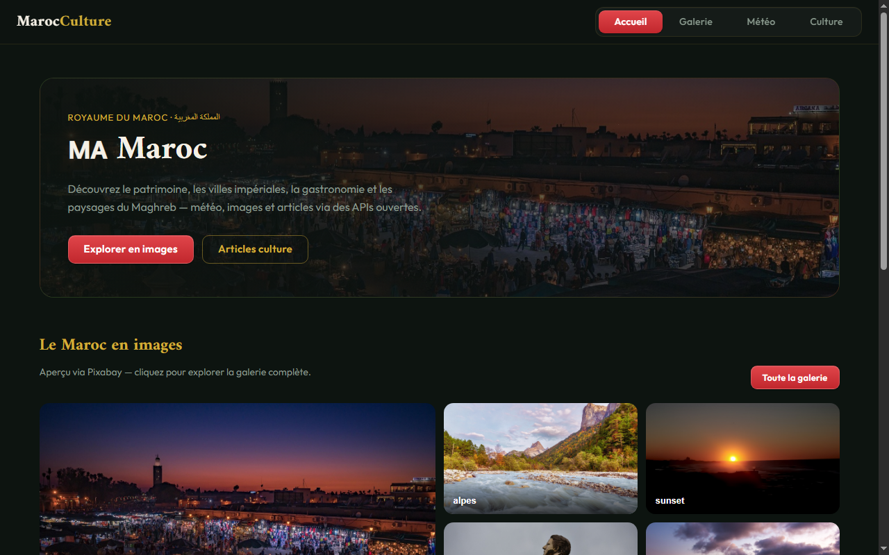

# MarocCulture — Portail Culturel & Découverte Visuelle du Maroc

> **Conçu & Développé par Mohammed AICHOUR**  
> *Ingénieur Logiciel & Architecte Web Full-Stack*

[](https://react.dev/)
[](https://getbootstrap.com/)
[](https://open-meteo.com/)
[](#)
[](https://mohammed-aichour.github.io/MarocCulture/)

<p align="center">
  
</p>

---

## 📌 Présentation du Projet

**MarocCulture** est une plateforme web interactive dédiée à la mise en valeur du patrimoine culturel, architectural, gastronomique et touristique du Royaume du Maroc.

L'application intègre plusieurs sources de données ouvertes en temps réel :
1. **Données Nationales (REST Countries API)** : Démographie, langues officielles, monnaie et géographie marocaine.
2. **Météo en direct multi-villes** : Consultation météorologique des 10 principales métropoles du Maroc (Casablanca, Rabat, Marrakech, Fès, Tanger, Agadir, Essaouira, Chefchaouen, etc.) via Open-Meteo sans dépendance de clé obligatoire.
3. **Galerie d'Art & Patrimoine** : Navigation visuelle fluide avec intégration Pixabay et images de secours haute résolution issues de Wikimedia Commons.
4. **Encyclopédie Culturelle** : Fiches thématiques sur la gastronomie, le zellige, les médinas impériales et l'artisanat marocain via les APIs Wikipédia.

---

## 🏗️ Architecture du Projet

```text
MarocCulture/
│
├── public/                     # Assets publics, favicon et manifest
│   ├── index.html
│   └── manifest.json
│
├── src/
│   ├── api/                    # Clients d'intégration des APIs REST
│   │   ├── country.js          # REST Countries API
│   │   ├── httpError.js        # Gestion centralisée des erreurs HTTP
│   │   ├── images.js           # Pixabay & fallback Wikimedia
│   │   ├── weather.js          # Open-Meteo & OpenWeatherMap
│   │   └── wikipedia.js        # API d'extraits encyclopédiques
│   ├── components/             # Composants modulaires React
│   │   ├── Culture/            # Fiches culturelles & cartes thématiques
│   │   ├── Gallery/            # Explorateur photo haute définition
│   │   ├── Home/               # Vue d'accueil immersive & sélecteurs
│   │   └── Weather/            # Météo héro & prévisions
│   ├── config.js               # Normalisation des villes et constantes
│   ├── config.test.js          # Suite de tests unitaires de normalisation
│   ├── App.js                  # Routage et orchestration d'état
│   └── App.test.js             # Tests de rendu des composants React
│
├── package.json
└── README.md
```

---

## 🚀 Installation & Démarrage

### Prérequis
- Node.js 18+
- npm ou yarn

### Lancement en développement
```bash
npm install
npm start
```
L'application démarre sur `http://localhost:3000`.

### Tests automatisés
```bash
npm test
```
*Taux de réussite des tests : 100% (2 suites / 4 tests).*

### Build de production
```bash
npm run build
```

---

## 👨‍💻 Auteur

**Mohammed AICHOUR**  
- GitHub : [@Mohammed-aichour](https://github.com/Mohammed-aichour)  
- Portfolio Officiel : Intégré au portail d'ingénierie officiel.
